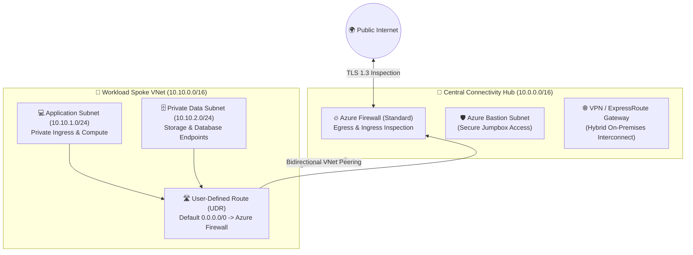

# 🏛️ Enterprise Azure Hub-and-Spoke Landing Zone (Terraform)

[](https://www.terraform.io/)
[](https://registry.terraform.io/providers/hashicorp/azurerm/latest)
[](https://github.com/sanjiivsingh/azure-enterprise-landing-zone-terraform/actions/workflows/ci-cd.yml)
[](https://learn.microsoft.com/en-us/azure/cloud-adoption-framework/)
[](https://opensource.org/licenses/MIT)

> **Production-ready Microsoft Azure Hub-and-Spoke Landing Zone** implemented using modular Terraform. Designed around Microsoft Cloud Adoption Framework (CAF) standards, featuring centralized Azure Firewall inspection, automated bidirectional VNet peering, custom User-Defined Routes (UDRs), Azure Bastion, and micro-segmented workload tiers.

---

## 📐 Network Topology & Traffic Routing



---

## 🎯 The Problem This Architecture Solves

Uncontrolled cloud adoption often results in:
1. **Network Sprawl & Point-to-Point Peering:** Workloads interconnected haphazardly without centralized perimeter controls.
2. **Uninspected Outbound Internet Traffic:** Resources having public IPs or unfiltered egress, creating exfiltration vulnerabilities.
3. **Complex Cross-Environment Routing:** Inability to inspect east-west (spoke-to-spoke) traffic without expensive third-party NVA appliances.

**Solution:** This Landing Zone implements a standardized transit Hub network routing all spoke-to-spoke and spoke-to-internet traffic through Azure Firewall via automated User-Defined Routes (UDR `0.0.0.0/0`).

---

## 📋 Prerequisites

Before deploying, ensure you have:
* **Terraform CLI**: `>= 1.9.0`
* **Azure CLI (`az`)**: `>= 2.60.0`
* **Azure Subscription**: Contributor or Owner role on target subscription
* **Authentication**: Run `az login` or configure service principal environment variables (`ARM_CLIENT_ID`, `ARM_CLIENT_SECRET`, `ARM_SUBSCRIPTION_ID`, `ARM_TENANT_ID`)

---

## ⚙️ Configuration & Usage

The repository uses decoupled environment root modules calling generic child modules in `modules/`:

```text
azure-enterprise-landing-zone-terraform/
├── environments/
│   └── dev/
│       ├── main.tf              # Environment root calling hub and spoke modules
│       ├── variables.tf         # Input declarations
│       ├── terraform.tfvars     # Parameter values (location, environment)
│       └── provider.tf          # AzureRM provider configuration
└── modules/
    ├── hub_network/             # Hub VNet, Azure Firewall, Bastion, GatewaySubnet
    └── spoke_network/           # Spoke VNet, Subnets, UDR table, VNet Peering
```

### 1. Initialize & Validate Locally

```bash
cd environments/dev
terraform init
terraform fmt -check
terraform validate
```

### 2. Preview & Review Plan

```bash
terraform plan -out=tfplan
```

### 3. Deploy

```bash
terraform apply tfplan
```

---

## 🧪 How to Run Validation & Tests

To execute the same shift-left security checks enforced in the automated CI/CD pipeline:

```bash
# 1. Format Check
terraform fmt -check -recursive

# 2. Static Analysis with TFLint
tflint --init
tflint --recursive

# 3. Security & Compliance SAST with Checkov
checkov -d . --framework terraform --output cli

# 4. Secrets Detection with Gitleaks
gitleaks detect --source . -v
```

---

## 🔄 CI/CD Workflow & Quality Gates

Every pull request and push to `main` automatically triggers `.github/workflows/ci-cd.yml` in GitHub Actions:
- **`terraform fmt -check`**: Strict style and syntax validation
- **`tflint`**: AzureRM ruleset verification for deprecated arguments and anti-patterns
- **`checkov`**: Policy-as-Code scan against CIS Microsoft Azure Foundations Benchmark
- **`gitleaks`**: Entropy analysis preventing accidental token or secret commits

---

## 🛡️ Security Considerations

* **Zero Public IPs on Spoke Workloads**: All spoke VMs and PaaS resources are provisioned on private subnets without public IPs.
* **Forced Egress Inspection**: Spoke subnets attach to a route table with `0.0.0.0/0` next hop type `VirtualAppliance` set to Azure Firewall's private IP (`10.0.1.4`).
* **Bastion Jumpbox Access**: Administration access is mediated through Azure Bastion over SSL/TLS—no management ports (22/3389) are exposed.
* **Isolated Subnet NSGs**: Strict Network Security Group rules deny lateral movement between subnets unless explicitly permitted.

---

## 📊 Current Implementation Status

* **Status**: **CI-Validated & Implemented / Locally Validated**
* **Provider**: `hashicorp/azurerm` (`~> 4.0`)
* **Terraform**: `~> 1.9.5`
* **Tagged Release**: `v1.0.0`

---

## 🧹 Cleanup & Resource Teardown

To avoid incurring ongoing Azure infrastructure charges (particularly for Azure Firewall and Azure Bastion):

```bash
cd environments/dev
terraform destroy -auto-approve
```

---

## 👨‍💻 Author & Cloud Consultant

**Sanjeev Kumar Singh**  
*Freelance Azure Cloud Engineer | Terraform & Infrastructure Automation*  
* 📧 **Email**: [sanjeevsinghred@gmail.com](mailto:sanjeevsinghred@gmail.com)
* 🌐 **Portfolio**: [sanjeevsingh.oneps.in](https://sanjeevsingh.oneps.in)
* 💼 **LinkedIn**: [linkedin.com/in/sanjiivsingh](https://linkedin.com/in/sanjiivsingh)
* 🐙 **GitHub**: [github.com/sanjiivsingh](https://github.com/sanjiivsingh)

---

## 📄 License
Licensed under the [MIT License](LICENSE).
