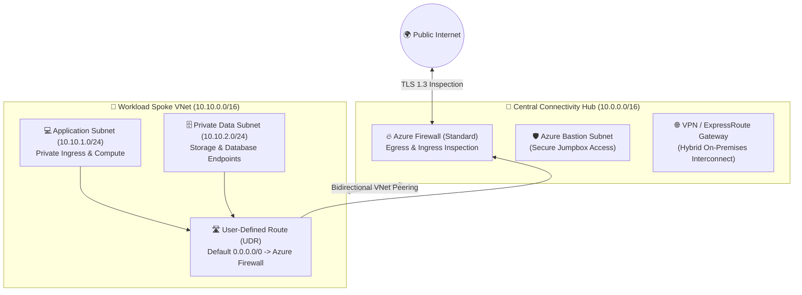

# 🏛️ Enterprise Azure Hub-and-Spoke Landing Zone (Terraform)

> **Production-grade Microsoft Azure Hub-and-Spoke Landing Zone** implemented using modular Terraform. Designed around Microsoft Cloud Adoption Framework (CAF) standards, featuring centralized Azure Firewall inspection, automated bidirectional VNet peering, custom User Defined Routes (UDRs), Azure Bastion, and micro-segmented workload tiers.

---

## 📐 Network Topology & Traffic Routing

---

## 🎯 Architecture Features
* **Centralized Egress Inspection**: Route tables enforce default route `0.0.0.0/0` to Azure Firewall private IP.
* **Automated Bidirectional VNet Peering**: Decoupled modules automatically link spoke VNets to the central transit hub.
* **Micro-Segmented Security**: Subnet-level Network Security Groups (NSGs) preventing unauthorized lateral movement.
* **Hybrid-Ready**: Dedicated GatewaySubnet pre-configured for ExpressRoute and Site-to-Site VPN failover.

---

## 👨‍💻 Author & Cloud Consultant

**Sanjeev Kumar Singh**  
*Senior Cloud & DevSecOps Platform Engineer*  
* 📧 **Email**: [sanjeevsinghred@gmail.com](mailto:sanjeevsinghred@gmail.com)
* 🌐 **Portfolio**: [sanjeevsingh.oneps.in](https://sanjeevsingh.oneps.in)
* 💼 **LinkedIn**: [linkedin.com/in/sanjiivsingh](https://linkedin.com/in/sanjiivsingh)
* 🐙 **GitHub**: [github.com/sanjiivsingh](https://github.com/sanjiivsingh)

---

## 📄 License
Licensed under the [MIT License](LICENSE).
