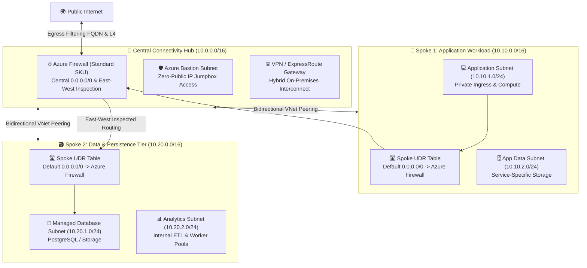

# 🏛️ Enterprise Azure Hub-and-Spoke Landing Zone (Terraform)

[](https://www.terraform.io/)
[](https://registry.terraform.io/providers/hashicorp/azurerm/latest)
[](https://github.com/sanjiivsingh/azure-enterprise-landing-zone-terraform/actions/workflows/ci-cd.yml)
[](docs/EVIDENCE.md)
[](LICENSE)

> **Reference Architecture · Statically Validated**  
> Enterprise Microsoft Azure Hub-and-Spoke Landing Zone implemented using modular, scalable Terraform child modules. Designed around Microsoft Cloud Adoption Framework (CAF) standards, featuring dynamic `locals.tf` CIDR derivation via `cidrsubnet()`, centralized Azure Firewall (Standard SKU) traffic inspection, automated bidirectional VNet peering, custom User-Defined Routes (UDRs), Azure Bastion jumpbox connectivity, and multi-spoke (App & Data) network isolation. Verification evidence is documented in [docs/EVIDENCE.md](docs/EVIDENCE.md) and architectural decisions in [docs/ARCHITECTURE.md](docs/ARCHITECTURE.md).

---

## 📐 Network Topology & Traffic Routing



---

## 🎯 The Problem This Architecture Solves

Uncontrolled cloud adoption often results in:
1. **Network Sprawl & Ad-Hoc Peering:** Workloads interconnected directly without perimeter inspection, breaking auditability.
2. **Uninspected Outbound Internet Traffic:** Workload resources having public IPs or unfiltered egress, creating exfiltration vulnerabilities.
3. **Uncontrolled East-West Traffic:** Uninspected traffic between app and database tiers.

**Solution:** This Landing Zone implements a standardized transit Hub network routing all spoke-to-spoke and spoke-to-internet traffic through Azure Firewall via automated User-Defined Routes (`0.0.0.0/0 -> module.hub_network["hub1"].firewall_private_ip`).

---

## ⚙️ Scalable Repository Structure

```text
azure-enterprise-landing-zone-terraform/
├── docs/
│   ├── ARCHITECTURE.md          # Architectural Decision Records (ADRs)
│   └── EVIDENCE.md              # CI run logs, test commands, and cost breakdown
├── environments/
│   ├── README.md                # Environment promotion & structure guide
│   ├── dev/
│   │   ├── main.tf              # Instantiates scalable child modules via for_each
│   │   ├── locals.tf            # Standard naming & dynamic CIDR computation (cidrsubnet)
│   │   ├── variables.tf         # Input schema declarations
│   │   ├── terraform.tfvars     # Dev environment configuration values
│   │   ├── outputs.tf           # Exposed Hub VNet ID, Firewall IP, and Spoke IDs
│   │   ├── provider.tf          # AzureRM provider block
│   │   ├── version.tf           # Terraform & AzureRM version constraints
│   │   ├── backend.tf           # Remote state backend template
│   │   └── README.md            # Detailed Dev deployment runbook
│   └── prod/
│       └── README.md            # Production deployment & hardening blueprint
└── modules/
    ├── README.md                # Modular child module catalog
    ├── resource-group/          # Decoupled Resource Group child module
    ├── hub-network/             # Hub VNet, Subnets, Azure Firewall (Standard), Bastion
    └── spoke-network/           # Spoke VNet, Dynamic Subnets, UDR table, Bidirectional Peering
```

---

## 📋 Dynamic `locals.tf` & Modular Design Pattern

Following the enterprise architecture of [`azure-hub-spoke-storage-private-endpoint`](https://github.com/sanjiivsingh/azure-hub-spoke-storage-private-endpoint):
1. **Scalable Child Modules**: Modules accept typed `*_config` objects without hardcoded environment identifiers or regional constraints.
2. **Algorithmic Subnetting**: `locals.tf` uses Terraform's built-in `cidrsubnet()` to compute non-overlapping subnets mathematically:
   ```hcl
   address_prefixes = [
     cidrsubnet(
       value.address_space[0],
       s_val.subnet_prefix - tonumber(split("/", value.address_space[0])[1]),
       s_val.subnet_num
     )
   ]
   ```
3. **Dynamic Orchestration**: `environments/dev/main.tf` instantiates resources using `for_each = local.*`, enabling arbitrary numbers of spoke networks (e.g. App, Data, AI, Shared Services) by simply extending `terraform.tfvars`.

---

## 📋 Authentication & Deployment

### 1. Passwordless CI/CD with GitHub OIDC
This project is designed for passwordless authentication via Microsoft Entra Workload Identity Federation (GitHub OIDC):
* Requires **no long-lived client secrets**.
* GitHub Actions requests a short-lived OIDC token validated by Azure federated credentials.

### 2. Local Initialization & Validation

```bash
cd environments/dev
terraform init -backend=false
terraform fmt -check -recursive
terraform validate
terraform plan
```

### 3. Cleanup & Resource Teardown

```bash
terraform destroy -auto-approve
```

---

## 🔄 CI/CD Workflow & Quality Gates

Every pull request and push to `main` automatically triggers `.github/workflows/ci-cd.yml` in GitHub Actions:
- **`terraform fmt -check`**: Strict syntax formatting check
- **`tflint`**: AzureRM ruleset verification for deprecated attributes and provider anti-patterns
- **`checkov`**: Policy-as-Code SAST scan against CIS Microsoft Azure Foundations Benchmark
- **`gitleaks`**: High-entropy analysis preventing secret or token leaks

---

## 🛡️ Security Implementation Details

* **Zero Public IPs on Spoke Workloads:** All spoke subnets remain private with no direct public IPs.
* **Dynamic Egress Routing:** Spoke route tables reference the Azure Firewall private IP dynamically via module output (`module.hub_network["hub1"].firewall_private_ip`).
* **Bastion Jumpbox Connectivity:** Management access is mediated through Azure Bastion without exposing SSH/RDP ports directly to the internet.
* **Standard SKU Alignment:** Configured for Azure Firewall Standard SKU (`sku_tier = "Standard"`, `sku_name = "AZFW_VNet"`), supporting Layer 4 network filtering and FQDN application rules without requiring custom enterprise CA certificates.

---

## 👨‍💻 Author & Cloud Architect

**Sanjeev Singh**  
*Senior Azure Cloud Architect & DevSecOps Platform Engineer*  
* 🌐 **Portfolio**: [sanjeevsingh.oneps.in](https://sanjeevsingh.oneps.in)  
* 💼 **LinkedIn**: [linkedin.com/in/sanjiivsingh](https://linkedin.com/in/sanjiivsingh)  
* 🐙 **GitHub**: [github.com/sanjiivsingh](https://github.com/sanjiivsingh)

---

## 📄 License
Licensed under the [MIT License](LICENSE).
