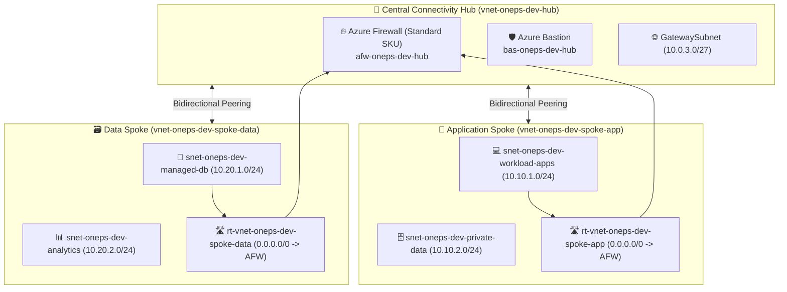

# Development Environment: Hub-and-Spoke Landing Zone

This directory contains the root orchestration layer for deploying the development instance of the Enterprise Azure Landing Zone.

---

## Architecture Blueprint



---

## Deployment Instructions

### 1. Initialize Working Directory
```bash
terraform init -backend=false
```

### 2. Validate Code Syntax & Configuration
```bash
terraform validate
```

### 3. Generate Execution Plan
```bash
terraform plan
```

### 4. Apply Infrastructure
```bash
terraform apply
```
