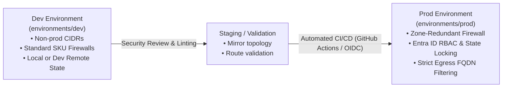

# Production Environment: Deployment & Hardening Guide

## Overview

The `environments/prod` directory is designated for the **Production deployment** of the Enterprise Azure Hub-and-Spoke Landing Zone infrastructure.

This guide details the architectural promotion strategy, security hardening, and enterprise best practices required when promoting infrastructure to a production Azure subscription.

---

## Promotion Workflow: From Dev to Prod



---

## Production Hardening Recommendations

| Area | Dev Implementation | Production Recommended Pattern | Rationale |
| :--- | :--- | :--- | :--- |
| **State Storage** | Local state / optional remote | **Azure Remote Backend** (`azurerm` with Blob lease locking & OIDC) | Prevents concurrent state corruption and ensures strict audit logs. |
| **Firewall SKU & Zones** | Standard single-instance | **Standard / Premium SKU across Availability Zones (1, 2, 3)** | Delivers 99.99% availability SLA and TLS inspection capabilities. |
| **Access Control** | Developer subscriptions | **Microsoft Entra ID Privileged Identity Management (PIM)** | Enforces just-in-time access and multi-factor approval for changes. |
| **Logging & Telemetry** | Local diagnostics | **Azure Monitor Diagnostic Settings & Sentinel SIEM** | Ingests NSG flow logs, Firewall network logs, and DNS query trails. |

---

## Production Deployment Execution

```bash
cd environments/prod
terraform init -backend-config=backend.hcl
terraform plan -out=prod.tfplan
terraform apply prod.tfplan
```
